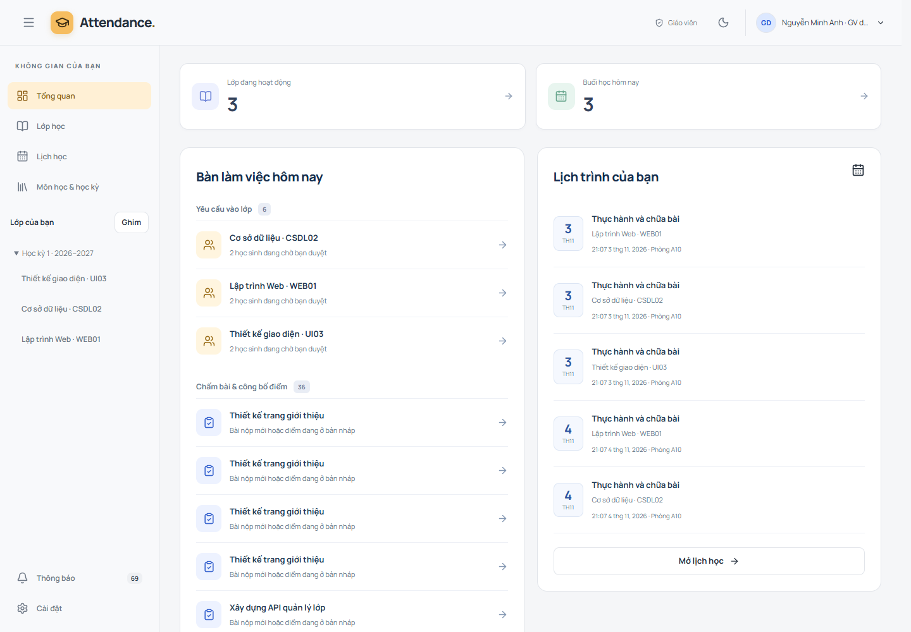
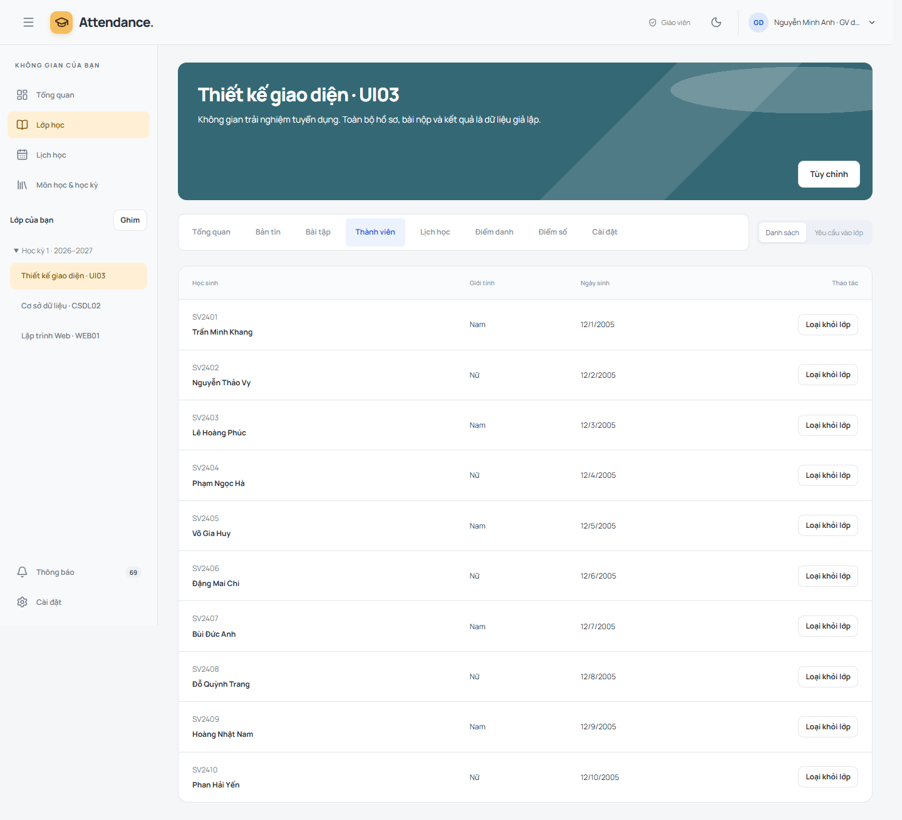
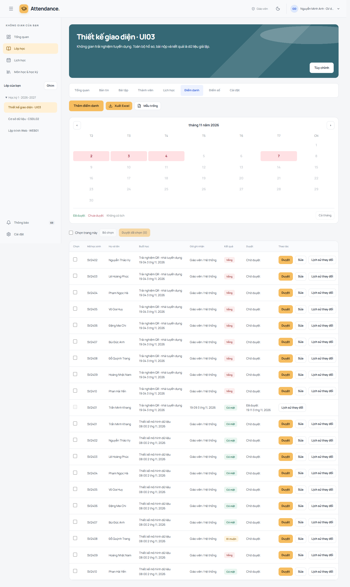
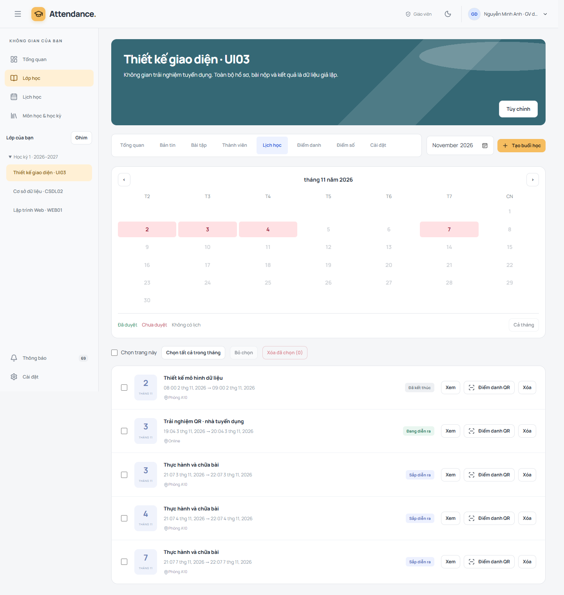
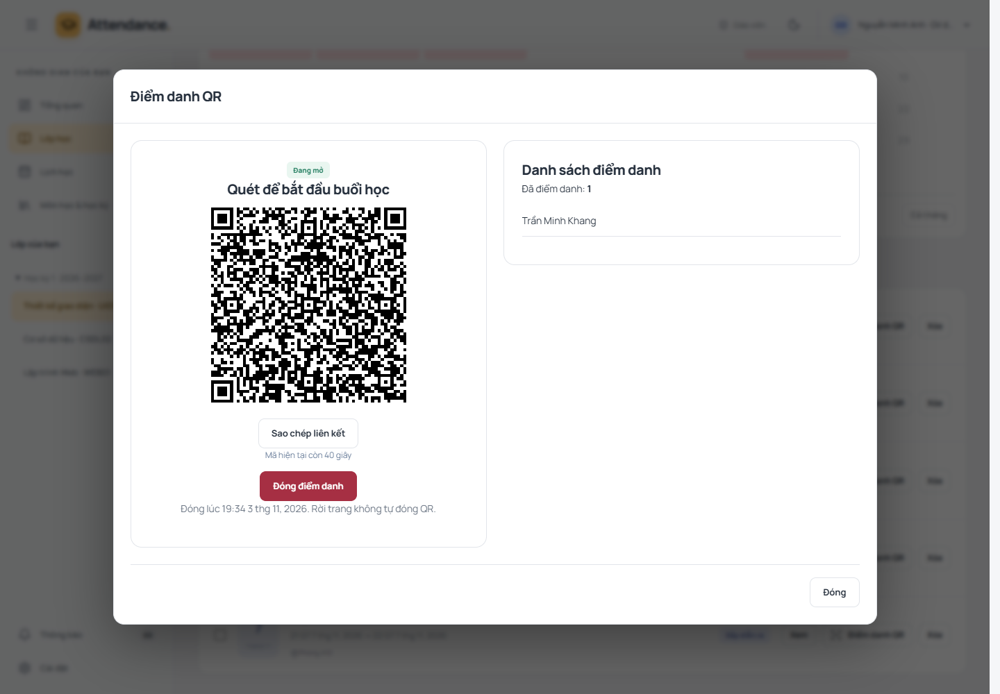

# AttendanceWeb

Ứng dụng quản lý lớp học và điểm danh QR cho giáo viên, học sinh. Dự án full-stack sử dụng **React · TypeScript · Laravel · MySQL**, tập trung vào phân quyền theo lớp, quy trình duyệt điểm danh và dữ liệu có lịch sử thay đổi.

**[Mở bản demo](https://attendanceweb-psi.vercel.app)** · [Ảnh từng chức năng](docs/FEATURE-TOUR.md) · [Thiết kế & quyết định](docs/14-architecture-decisions.md) · [API và hướng dẫn backend](docs/API-CURRENT.md)

## Thử ngay — dành cho nhà tuyển dụng

| Vai trò | Email | Mật khẩu |
| --- | --- | --- |
| Giáo viên | teacher@demo.attendance.test | AttendanceDemo!2026 |
| Học sinh | student@demo.attendance.test | AttendanceDemo!2026 |

Đây là tài khoản công khai chuyên dùng cho trải nghiệm, không phải thông tin đăng nhập quản trị. Dùng hai cửa sổ trình duyệt hoặc chế độ ẩn danh để thử đồng thời hai vai trò. Server miễn phí có thể cần một lúc để khởi động ở lượt truy cập đầu.

**Tất cả dữ liệu là giả lập:** tên, mã sinh viên, ngày sinh, bài nộp và kết quả. Không nhập thông tin thật. Nhiều người dùng chung tài khoản nên có thể thấy thay đổi của người thử khác. Demo giữ nguyên hồ sơ/mật khẩu và không nhận tệp tải lên; vẫn thử được nộp bài bằng ghi chú, chấm điểm và công bố.

Bộ demo tự khôi phục sau 24 giờ hoặc khi vượt ngưỡng dữ liệu. Kiểm tra mỗi giờ khi server thức; nếu server ngủ, lần khởi động hoặc đăng nhập demo hợp lệ tiếp theo sẽ chạy bù. Các thay đổi thử nghiệm có thể mất và đường dẫn lớp cũ có thể hết hiệu lực. Chỉ dữ liệu thuộc bộ demo tuyển dụng được reset; tài khoản/lớp khác được giữ nguyên. [Quy tắc reset & giới hạn](docs/PORTFOLIO-DEMO.md).

## Kịch bản trải nghiệm 5 phút

1. Đăng nhập **Giáo viên**: Tổng quan có yêu cầu vào lớp, bài chờ chấm và lịch sắp tới.
2. Mở một lớp → **Thành viên** → Yêu cầu vào lớp; thử duyệt một yêu cầu.
3. Trong **Lịch học**, chọn ngày trên lịch để lọc; tạo một buổi hoặc lặp tuần và xem trước trước khi xác nhận.
4. Nhấn **Điểm danh QR** ở buổi học → mở cửa sổ → sao chép liên kết. Ở cửa sổ **Học sinh**, mở liên kết và xác nhận. Học sinh đã được duyệt vào lớp có thể điểm danh; chỉ được ghi nhận một lần cho mỗi buổi.
5. Giáo viên đóng QR → **Điểm danh**: thêm/sửa thủ công kèm lý do nếu cần, chọn checkbox để duyệt từng hoặc hàng loạt. Bản ghi đã duyệt bị khóa sửa.
6. Thử **Bài tập** → xem bài nộp → lưu điểm nháp/công bố. Học sinh chỉ thấy bài nộp và điểm của mình.
7. Xem **Bản tin**, viết bài và bình luận trực tiếp. Menu ba chấm chứa các thao tác bài viết. Thử chế độ tối hoặc banner, ghim/ẩn lớp trên sidebar.

## Các chức năng hiện có

| Nhóm | Hành vi |
| --- | --- |
| Lớp & học kỳ | Môn/học kỳ riêng từng giáo viên, mã tham gia, yêu cầu chờ duyệt, quản lý thành viên, cài đặt lớp |
| Lịch học | Một buổi/lặp tuần, nhập tay hoặc lịch chọn ngày giờ, xem trước, kiểm tra trùng, chọn/xóa nhiều buổi theo điều kiện lịch sử |
| QR & điểm danh | QR đổi mỗi 30 giây, TTL tối đa 60 giây; kiểm tra quyền và thời gian trên server; thêm thành viên đã duyệt; chặn quét lại |
| Duyệt & truy vết | Sửa tay có lý do, audit trước/sau, duyệt và khóa bản ghi; lịch tháng đỏ/chưa hoàn tất, xanh/đã xử lý |
| Bài tập & điểm | Nháp/công bố bài tập, phiên bản bài nộp, điểm nháp/công bố, bảng điểm; upload/download riêng tư có trong API nhưng upload tắt trên tài khoản demo |
| Bản tin | Bài viết, ghim/ẩn, bình luận trực tiếp và kiểm duyệt |
| Tiện ích | Xuất Excel theo quyền, inbox thông báo, hồ sơ, giao diện sáng/tối, banner và sidebar lưu theo tài khoản |
| Responsive | Desktop dùng bảng rộng, mobile dùng bố cục gọn; form tạo/sửa mở modal |

## Điểm kỹ thuật

- React chia app/domain/application/infrastructure/features/shared; TanStack Query quản lý dữ liệu server, TypeScript kiểm tra contract.
- Laravel tách controller, FormRequest, Policy/Resource và action nghiệp vụ; transaction cho các thay đổi liên quan.
- Cookie session + CSRF, kiểm tra owner/thành viên ở API, download và export; kiểm tra version để tránh ghi đè dữ liệu cũ.
- QR được ký trên server; không dùng giờ hiển thị trên máy người dùng để quyết định hợp lệ. Không dùng GPS hoặc nhận diện khuôn mặt.
- Marker demo riêng, khóa transaction và xóa phụ thuộc theo phạm vi owner để reset; không xóa toàn bộ database và không tắt khóa ngoại.
- Frontend trên Vercel, Laravel Docker trên Render, MySQL trên Aiven. Source và lockfile được lưu trong repository.

## Ảnh giao diện

| Quản lý lớp | Điểm danh |
| --- | --- |
|  |  |
|  |  |

[Thư viện ảnh đầy đủ: giáo viên, học sinh và mobile](docs/FEATURE-TOUR.md). Ảnh chụp từ bản chạy thật với bộ demo giả lập, không phải mockup.

## Chưa áp dụng / hướng phát triển

| Hạng mục | Trạng thái |
| --- | --- |
| Đăng nhập/đăng ký Google | Chưa tích hợp OAuth |
| Email xác minh/khôi phục trên demo | Chưa gửi email thật; dùng tài khoản được cung cấp để trải nghiệm |
| Trắc nghiệm, chat riêng, realtime push | Chưa triển khai; thuộc kế hoạch tương lai |
| Upload tệp trên tài khoản công khai | Tắt để hạn chế spam; bài nộp demo dùng ghi chú |
| Camera trên mọi thiết bị | Có luồng quét QR; phụ thuộc quyền camera/HTTPS/phần cứng. Kiểm tra live của bản này dùng liên kết QR, không khẳng định đã kiểm tra mọi camera |
| Tác vụ nền khi đóng trình duyệt | Thao tác UI nền chạy trong phiên trình duyệt; chưa phải hàng đợi bền vững/offline |

Không coi các tài liệu mục tiêu cũ là bằng chứng mọi tính năng đã hoàn thành. [Worklog](docs/worklog.md) ghi rõ phần code, kiểm thử local và kiểm chứng production.

## Chạy local

Yêu cầu PHP 8.4+, Composer, MySQL 8 và Node 24. Không sử dụng cấu hình/secret production để chạy thử.

Backend (trong attendance_api):

~~~sh
composer install
cp .env.example .env
php artisan key:generate
# Cấu hình database MySQL riêng trong .env trước bước tiếp theo.
php artisan migrate
php artisan serve
~~~

Frontend (trong atd_react):

~~~sh
npm ci
npm run dev
~~~

Cấu hình VITE_API_ORIGIN và cookie/CORS cho địa chỉ API local theo [hướng dẫn React](docs/FRONTEND-IMPLEMENTATION.md). Bộ recruiter demo được giới hạn vào môi trường test biệt lập hoặc dịch vụ đã duyệt; không bật seeder demo tùy tiện trên database khác.

Kiểm tra frontend: npm run lint, npm test, npm run build. Backend: php artisan test trên database test riêng, vendor/bin/pint --dirty. [Bằng chứng kiểm tra portfolio](docs/evidence/portfolio-validation.md).

## Cấu trúc repository

| Thư mục | Nội dung |
| --- | --- |
| attendance_api | Laravel REST API, migrations và PHPUnit |
| atd_react | React/TypeScript/Vite, UI theo feature, Vitest/Playwright |
| docs | Đặc tả, quyết định kiến trúc, bằng chứng và ảnh chức năng |
| scripts | Công cụ phát triển và kiểm tra |

Tác giả: [Đinh Văn Tài](https://github.com/taiDinh303).
